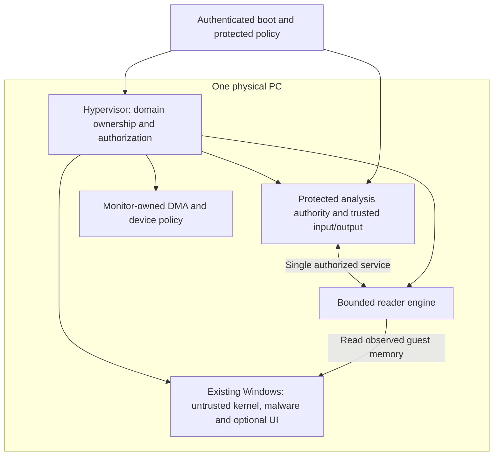

# Private reader interface: same-PC rewrite plan

Updated 2026-09-26 against the current working tree and the added client library.

**Current delivery:** the unauthenticated guest reader and experiment are retired.
The rebuilt client and CLI fail locally before native calls. Runtime fault evidence
is retained privately; only a closed coarse stop category may be exported after
the collective stop barrier and endpoint revalidation. This is a reader-disabled
interim stage, not a working authenticated reader and not kernel-resistant privacy.
The implementation and validation gates below distinguish those outcomes.

**Fresh review checkpoint:** independent platform and authorization reviews selected
real monitor-owned DMA protection as the next common security milestone. BIOS
IOMMU enablement is a prerequisite, not proof of protected mappings or ownership.
Do not introduce a token/domain abstraction before its actual authority producer
exists. The full interactive client remains the target; fixed recording jobs are
an alternative workflow that has not been selected.

**Discovery implementation checkpoint:** [firmware discovery](IOMMU-DISCOVERY.md)
adds bounded IVRS/MCFG parsing and a pre-ExitBootServices acquisition path. It
retains aliases, exclusions and unresolved declarations, corroborates documented
PCI/MMIO state through validated read-only access, and carries a compact result
in the existing final boot record. No IOMMU takeover or protected authority is
created. Inventory is informational for this reader-disabled build; the later
ownership transaction must refuse unresolved inputs. A BIOS binary is not needed
for this slice. Firmware execution and DMA-denial evidence remain outstanding.

**Ownership preparation checkpoint:** [offline ownership components](IOMMU-OWNERSHIP.md)
now include strict entry and command codecs, a bounded page-table image builder
and an independent host walker. The builder checks protected physical outputs
and all assigned table backing before mutation; command values are never
submitted. They do not select the actual device/interrupt or Windows
coexistence policy, or program hardware. Fresh review also fixed conflicting
special-device source settings and PCID-tag handling in discovery admission.
Complete PCI/MMIO effects, command-memory and reset ownership remain missing.
Firmware execution, DMA enforcement and protected client execution are still
required before this reader can be enabled.

**Control preparation checkpoint:** every vCPU now binds one retained firmware
configuration-route expectation, owns CF8-CFF and both route-MSR directions,
and checks route/intercept drift independently of diagnostics. Every firmware
NPT construction reapplies the common ECAM write guard. Broad ECAM write windows
and diagnostic native PCI forwarding are removed. Only selector operations,
route reads and exact unchanged route writes are supported; PCI data, ECAM
writes and reset/route changes stop without pretending success. This strict
intermediate build cannot be treated as an ordinary Windows deployment.
Bounded page-granular NPT denial construction and cache rebuild preservation are
implemented and tested, including software alias refusal. Actual IOMMU control
ranges are deliberately not activated from the informational discovery report.
The shared expectation has CPU NPT protection, not established DMA protection.

**Retained inventory and full-entry checkpoint:** the complete historical
discovery report now has a 64KiB shared region inside the retained pool. Acquisition
writes it directly after native memory admission; every private host root maps
it read-only/NX and every guest NPT excludes the entire assigned tail. Callbacks
validate only the scalar publication/context header. Full report lifetime is established for CPU access, while
DMA integrity and fresh current-state corroboration remain prerequisites.
Restricted complete 256-bit DTE and basic interrupt-entry codecs now require an
explicit interrupt policy. They do not install requester tables; SMI
requires separate controls and basic remapping requires actual GAEn=0 evidence.

**Retained resources checkpoint:** directory version 17 binds a shared 0x3262000
tail: the 64KiB observation, four 0x810000-byte unit slots, a 0x12000-byte
presentation and one 18MiB serialized mapping workspace. Every unit slot has
a full 2MiB deny device table, an empty root, command/event/completion pages and
two zeroed 3MiB composition destinations. Each destination has a full device table
and 256 translation/interrupt pages; every constructed image must pass an exact
capacity check. All bytes, including unused slots and padding, have retained
lifetime and guest CPU exclusion. The observation is private RO/NX; hardware and
composition storage is private RW/NX. Independent verification precedes bank
header publication; zeroed composition destinations are not installable policies.
The disconnected queue supports bounded transactional enqueue and wraparound,
but numeric head/completion samples grant no hardware completion authority.
The native installer initializes all four slots. A later owner must reject excess
units and separately admit per-unit policy, optional buffers, DMA integrity and
Windows coexistence before publishing hardware pointers.

**Requester and binding checkpoint:** bounded offline resolution now preserves
actual requester, alias source, unit and declaration provenance without selecting
a winning IVHD form. The captured ordinary/alias overlap remains a concrete
refusal, as do incompatible shared-source settings. A separate binder checks a
complete explicit assignment of verified candidate banks to observed units and
their exact control apertures. Integration tests combine those results with NPT
holes and cache rebuilds. Neither component is connected to native activation or
creates authority; hardware ownership and protected interactive execution remain
the major client gates.

**Executable ownership-core checkpoint:** the selected virtual AMD IOMMU now
has bounded copied-table composition, virtual register/command/event handling,
and shared publication correlation. A synthetic PCI fabric and injected-backend
multi-unit takeover transaction exercise the surrounding effects and failure
retention. Their cross-component tests still perform no hardware access. Native
firmware publication, current control/resource admission, coherent table-write
tracking and physical effects remain missing. The
[implementation and recovery checkpoint](OWNERSHIP-CANDIDATE.md) states why the
current artifact cannot yet be used for the Windows cold-boot milestone.

## Requirements and trust boundary

One physical PC, one hypervisor and the existing Windows installation remain the
deployment target. Malware may control an administrator account and that Windows
kernel. It may call our API first, impersonate a Windows process, modify its memory,
observe its requests/results, tamper with guest memory or DMA-capable devices,
and reboot the machine. The user wants both unauthorized reader use prevented and
analysis protected from that environment.

Windows-owned process state is not an authority. PID, image name, CR3, CPL3,
thread affinity, locked pages, a private function address and a secret embedded
in the Windows client do not authenticate a caller against its own kernel.
Guest process lists and sampled bytes also remain adversary-controlled evidence.

A token handed to the first caller does not solve enrollment: an attacker can
arrive first; after legitimate enrollment the kernel can steal or use a token
held by a Windows process. Rotating it, making it single-use, or placing it in
locked pages does not repair that boundary. Tokens become useful only after
trusted identity, protected delivery/storage and a scoped authorization policy
already exist. A TPM-backed nonexportable key alone likewise does not establish
that requests to use it came from an uncompromised Windows application.

Analysis authority, requests and sensitive results must be outside the Windows
guest's control, on this same PC. That does not inherently require another VM:
a monitor-resident worker can execute immutable approved jobs. Preserving arbitrary
interactive reads additionally requires trusted input/output and execution, which
could live in a monitor-owned component or a separately isolated client domain.
Neither architecture is implemented or proven feasible on this board yet. A second
Windows installation or physical computer is not assumed. The existing Win32 picker
cannot authenticate user intent or protect displayed results against its own kernel.
A protected component forwarding arbitrary requests from that picker would let
kernel malware exercise the same authority.

[Client integration](../../client/INTEGRATION.md) identifies the reusable code,
the concrete Windows/device and protected-peer demonstrations still required,
and the first authorized-read milestone. More offline helpers alone cannot
substitute for those integration decisions and deployment evidence.

Trusted firmware, authenticated resident/analysis code and their update policy
form the root of trust. Compromised firmware/SMM or hardware, physical attacks and
microarchitectural side channels are outside the initial guarantee. A hostile
kernel can deny service and change the memory being examined. Neither isolation
nor removal of PROBE guarantees that malware cannot detect virtualization or infer
observation and change behavior.

## Architecture and evidence

The diagram describes trust roles, not a committed second-VM topology. For an
isolated client, the hypervisor must derive identity from its own protected
execution/memory ownership. For a monitor worker, trusted control flow invokes
an internally approved job; a Windows request cannot create that authority.
A caller-supplied domain number, CR3 or first-call claim cannot select identity.
Buffers and retained results must have explicit ownership. If an untrusted Windows relay carries messages,
an established authenticated encrypted channel must terminate outside Windows.
A monitor-owned private domain channel may instead rely on demonstrated domain
isolation; an external TLS client is not a requirement of this same-PC plan.

Public protocol versions, operation codes, format markers and verification keys
are not secret credentials. Removing magic-based selectors retires an ABI.
Randomizing public bytes is not the authorization design, and signatures used
to authenticate trusted code must not be removed.

The inventory followed [docs/README.md](C:/Users/mato/Documents/svmvisor/docs/README.md).
Manual references below are physical PDF pages, read from indexed text. Source
behavior was checked against crates; no optional hardware feature is assumed.

| Evidence | Consequence |
| --- | --- |
| [24593_3.44_APM_Vol2 p593](C:/Users/mato/Documents/svmvisor/docs/24593_3.44_APM_Vol2/page_593.txt) | VMMCALL supplies no inherent CPL authentication; the monitor must decide admission. |
| [24593_3.44_APM_Vol2 p614](C:/Users/mato/Documents/svmvisor/docs/24593_3.44_APM_Vol2/page_614.txt) | Nested permission checks can enforce CPU memory exclusions despite guest CR0.WP. |
| [24593_3.44_APM_Vol2 p603](C:/Users/mato/Documents/svmvisor/docs/24593_3.44_APM_Vol2/page_603.txt) | CPU memory permissions alone do not constrain device DMA. The older DEV description is not evidence of usable platform support. |
| [48882-3.11 p35](C:/Users/mato/Documents/svmvisor/docs/48882-3.11/page_35.txt), [p36](C:/Users/mato/Documents/svmvisor/docs/48882-3.11/page_36.txt) | An untrusted guest must not control the real IOMMU device table or command interface protecting the analysis domain. |
| [48882-3.11 p54](C:/Users/mato/Documents/svmvisor/docs/48882-3.11/page_54.txt) | The IOMMU exclusion range permits read/write translations; it is not a denied monitor-memory range. |
| [runtime/mod.rs](C:/Users/mato/Documents/svmvisor/crates/hypervisor/src/host/resident/runtime/mod.rs), [interrupt.rs](C:/Users/mato/Documents/svmvisor/crates/hypervisor/src/host/resident/runtime/interrupt.rs) | The runtime currently owns one nonmigrating guest context per CPU and direct physical interrupt delivery. It has no analysis-domain scheduler/lifecycle. |
| [identity.rs](C:/Users/mato/Documents/svmvisor/crates/hypervisor/src/memory/npt/identity.rs), [boot/memory.rs](C:/Users/mato/Documents/svmvisor/crates/hypervisor/src/boot/memory.rs) | Current NPT and software readers exclude the monitor pool; this explicitly is not a DMA or general analysis-domain boundary. |
| [arm.rs](C:/Users/mato/Documents/svmvisor/crates/hypervisor/src/host/resident/runtime/arm.rs), [startup.rs](C:/Users/mato/Documents/svmvisor/crates/hypervisor/src/host/resident/runtime/startup.rs) | Guest device/interrupt access is largely native. Trusted analysis I/O cannot simply share Windows-controlled devices. |
| [child_image.rs](C:/Users/mato/Documents/svmvisor/crates/card-loader/src/delivery/child_image.rs) | Production hashes and LoadImage rejection are useful checks; the development loader adopts its payload header. Neither proves protected boot policy, enrollment or rollback resistance. |
| [client runtime wrapper](C:/Users/mato/Documents/svmvisor/client/src/core/runtime.rs) | The supplied client is a Windows library with a Win32 picker, not an isolated analysis runtime. Reusing its parsing/core logic requires a protected host and a new I/O boundary. |

No implemented IOMMU ownership, protected enrollment, entropy integration or
isolated analysis execution was found in the inspected source. Those are explicit
implementation gates; selecting a feature flag does not supply them.

The fresh read-only machine inventory reports a Ryzen 9 9900X (12 cores/24 logical
processors), B850 AORUS ELITE WIFI7, Windows 11 Pro build 26200, integrated AMD
graphics and an RTX 5060 Ti. These are Windows observations, not trusted boot
evidence. Secure Boot status could not be read at current privileges. Windows'
HypervisorPresent=false does not establish absence of this native-CPUID runtime.
IVRS and MCFG were captured through read-only Windows firmware-table APIs;
their checksums passed, but their origin and active hardware enforcement remain
unverified. The capture and exact hashes are retained under
target/fresh-private-interface-review/. No register was programmed.

The captured IVRS describes the same IOMMU through type 10h, 11h and 40h blocks;
these must not be counted as three independent units. It advertises preboot DMA
remapping and includes firmware memory exclusions. Numeric overlap between a
normal device range and an alias range is forbidden by the referenced IVHD rules.
The affected declarations need corroboration or diagnosed correction and trusted
boot validation before per-device ownership can be claimed. It is an
unresolved mapping question, not proof that the hardware is unusable.

## Stage A: completed interface retirement

The protocol, client and provisioning agents implemented these changes with
separate file ownership. Root integrates and arranges cross-review. Preexisting
working-tree changes, including exception-handling work, are preserved.

| Surface | Interim behavior |
| --- | --- |
| PROBE/SUBMIT/STEP/ABORT/CONTEXT | Shared local ABI, guest dispatch and service adapter removed. Post-bootstrap VMMCALL follows the existing architectural fault path at every CPL. |
| ARM/QUERY experiment | Shared entry ABI, runtime hooks, native client and production feature removed. Useful inert trial primitives remain offline only. |
| Bootstrap ACK | Required one-shot launch proof retained; it cannot grant reader access. The initial owner check and post-ACK rejection are validated separately. |
| Native lifecycle and fault handling | INIT/SIPI, EFER/VM_CR/MSR ownership, pending delivery, NPT exclusions and required stop coordination retained. |
| Runtime diagnostics | Progress, register context, fault flush and terminal aggregate exports remain removed. Only a closed coarse stop category can be exported after endpoint revalidation and the all-CPU terminal barrier; detailed first-fault and stop state stay private. |
| Firmware/card boot records | Still present as boot/admission diagnostics. They are not a reader command dispatcher; their provenance and contents must be covered by the protected-boot work. |
| Svm::connect and added client | Safe unconditional ReaderDisabled before profile/discovery/native work. Windows hypercall transport removed; live-reader forbids unsafe code. |
| live-read and entry-trial tools | Explicit disabled/retired error before native execution; live-read does not open requested streams or output files. Old flags cannot enable a hidden fallback. |
| Build and card verifier | resident-runtime selected with entry_trial=false, reader_enabled=false, authenticated_reader=false. Legacy reader/experiment exports are rejected; architectural audits remain. |
| Reader engine and codecs | Bounded offline reading, process revalidation, sample validation and fixtures retained without guest runtime admission. |

Necessary hardware behavior and bootstrap acknowledgement are not additional
application APIs. Do not delete them to make an overbroad claim of having no entry
points. Conversely, do not relabel an unauthenticated status/read endpoint as a
bootstrap or diagnostic exception.

## Stage B: establish the same-PC isolation foundation

Root owns integration. The provisioning agent owns loader, platform and lifecycle
work; the protocol agent owns domain/memory ownership; the client agent owns
portability and trusted I/O. Agree file ownership before concurrent edits.

1. **Protected boot and enrollment.** Specify the approved loader, resident,
   analysis image, FPGA/configuration and update chain; reject unauthorized or
   rollback images and unsafe development-loader profiles. Define recovery and
   revocation. Keep private credentials out of sources, guest handoff records,
   build evidence and logs. Validate entropy availability before issuing any
   cryptographic credential; missing entropy disables protected activation.

2. **Protected analysis lifecycle.** Preserve the interactive workflow as the
   full target and establish its trusted input/result path before choosing the
   execution architecture. A separate domain needs owned CPU state, stacks,
   memory, scheduler/interrupt handling and explicit create/start/stop/reset
   ownership. A monitor worker avoids that second-guest requirement but cannot
   treat arbitrary Windows commands as approved jobs. Existing opportunistic
   VM exits provide no bounded sampling cadence. Windows must not replace the
   analysis image/policy, mint authority or control protected entry state.

3. **CPU and DMA memory ownership.** Partition guest/analysis/monitor memory,
   including firmware handoff and temporary copies. Preserve monitor exclusions
   through physical reads, virtual walks, instruction fetch and write aliases.
   Establish actual IOMMU device topology, real table/command ownership,
   invalidation and reset behavior before retaining credentials. A DMA policy
   configured by the hostile Windows kernel is insufficient. Do not admit
   devices/topologies whose isolation cannot be established.

   The first common implementation target is protection of the existing retained
   monitor arena against all admitted DMA requesters. Start with validated,
   board-bounded IVRS/MCFG ingestion and exact requester/alias/reservation handling;
   then own real device, translation, command and event tables, invalidations and
   reset transitions. Protect those tables and both PCI configuration paths as
   well as MMIO control registers. Temporary ECAM write windows have been removed;
   replacement device effects still need an explicit mediated policy.

   Decide Windows coexistence explicitly. A candidate static profile puts all
   Windows devices in one monitor-owned identity DMA domain with no guest IOMMU
   advertised; it needs a consistent guest firmware/configuration view and actual
   Windows/device testing. If Windows needs an IOMMU interface, a shadow virtual
   IOMMU is a larger implementation. Advertising the real IVRS while simply
   refusing the Windows driver's writes is not an acceptable coexistence design.
   Preserve firmware reservations without granting DMA into protected memory;
   reject unresolved bypasses, alias ambiguities and reset/ATS/peer-to-peer cases.
   Inventory/parser tests alone do not complete this milestone.

   **Current implementation:** bounded firmware discovery plus offline entry,
   image and command preparation, with the reader still disabled and no IOMMU
   programming. The acquisition path records pre-Windows IVRS/MCFG, real PCI
   IOMMU capability and documented MMIO feature/state and buffer addresses. It
   does not follow or own existing mappings/queues. Firmware execution and
   configuration/reset-path evidence remain pending. Use Windows captures only
   as offline fixtures. Permanent route interception and ECAM write refusal now
   operate independently of diagnostics, and the NPT builder supports permanent
   control holes across rebuilds. Full historical discovery now resides in the
   CPU-excluded retained pool; complete restricted device entries have explicit
   interrupt behavior. One uninstalled deny/empty resource bank now has retained
   lifetime and CPU exclusion. Next implement the allowed PCI/ECAM effect policy,
   freshly corroborate discovery for takeover, and bind complete per-unit
   resources under a DMA-integrity/lifecycle policy before control denial.
   Record which evidence is still needed to choose a static no-vIOMMU profile or
   a shadow vIOMMU. Discovery alone cannot settle Windows/device compatibility,
   fabric bypasses or reset ownership; do not fabricate an isolation-established
   flag. Unknown/ambiguous topology must remain explicit rather than selecting
   first/last entry silently.
   Then implement the actual ownership transition and demonstrate both DMA denial
   and ordinary Windows storage/GPU/input/network operation before admitting reads.
   Measure idle exits and host CPU use, per-exit work, frame-time spikes and
   storage/network latency against the baseline. An apparently idle desktop may
   still have drivers polling configuration; do not infer low overhead from an
   absence of application activity. The current retention code adds no periodic
   exit mechanism, but coexistence/interrupt/service policy remains unmeasured.

4. **Trusted input and result destination.** Port the usable client core into the
   protected analysis environment and define its minimal dependencies. Establish
   a protected input/display/storage path or equivalent trusted result consumer.
   Rendering sensitive results in Windows gives the hostile kernel those results.
   A Windows convenience UI can request actions only under explicit policy;
   it cannot approve privileged actions or receive protected secrets by default.

5. **Platform gate.** Record measured resource use, available memory/cores and
   device requirements. If this platform cannot satisfy the boundary while
   continuing Windows, report that limitation and retain disabled reading.
   No automatic fallback to a normal Windows token client is permitted.

Exit evidence: verified boot/enrollment and domain ownership; guest attempts to
access domain memory and DMA fail on the admitted platform; reset/update cannot
restore old authority; trusted requests/results stay outside Windows. These are
hardware and lifecycle requirements, not just unit-test assertions.

## Stage C: one authorized service

The protocol agent owns service admission/state; the client agent owns the peer.
A different agent reviews the boundary before integration.

- Derive caller identity from the protected domain owner. Authenticate and
  authorize before installing ownership, invoking the reader or releasing context.
  A first caller does not become the owner simply by winning a race.
- Use scoped capabilities or session tokens only inside that established boundary.
  Bind authority to domain/endpoint, fresh boot/session, allowed operation,
  target/scope and recipient. No universal embedded bearer secret.
- Preserve HELLO as compatibility negotiation after admission. It does not itself
  authenticate. Version mismatch closes the service without a legacy retry.
- Route context, discovery, physical/virtual reads, bind/sample, continuation and
  cancellation through the same authorization policy. Raw physical/arbitrary-root
  reads need explicit scope; a guest PID/name or matching profile does not grant it.
- Specify disabled, authenticating, authorized, closing and revoked states.
  Reject duplicate/stale requests across reset/INIT, reconnect and CPU changes.
  Define coordinated state if requests can cross CPUs; a per-CPU counter alone
  does not establish global replay protection.
- A new HELLO or cancellation cannot evict another authorized owner. Malformed
  requests cannot allocate unbounded state, invoke read callbacks or disclose
  results. Keep bounded framing, callback limits, retranslation and partial-output
  rejection. Specify sequence exhaustion and failure cleanup.
- If an untrusted relay is selected, use a reviewed authenticated channel and
  cryptographic implementation with mutual endpoint policy and replay protection.
  Do not compose encryption/authentication around the existing CRC. Verify
  freestanding linkage, resource bounds and no-FP/SIMD/xstate requirements.
- Erase transient credentials/results on lifecycle transitions. Keep secrets and
  protected state out of public diagnostics, crash/export buffers and card records.
  Do not add another management/query interface as a convenient exception.

Exit evidence: all engine/context/result paths require protected identity and
operation policy; incorrect, stale and revoked authority cannot read, cancel,
take over a session or receive plaintext. Authorized reads and HELLO must actually
work before the stage is complete.

## Stage D: migration, validation and release

| Area | Required evidence |
| --- | --- |
| Interface closure | Retired selectors do not alias privileged work. Source reachability review plus linked-artifact checks; a string scan alone is insufficient. |
| Boot and exceptions | One-shot ACK owner checks and post-ACK rejection; preserved registers/flags/pending delivery for unclaimed calls; required INIT/SIPI and MSR behavior. |
| Authentication and policy | First-caller attacker, impersonated domain, missing/wrong/stale/revoked token, unauthorized scope, cancellation and takeover all denied before engine callbacks. |
| Identity and replay | Substituted images/trust policy, duplicate/out-of-order frames, truncation, reset/INIT, reconnect, CPU migration and sequence exhaustion cannot restore authority. |
| Isolation | Every read/write/translation alias denies protected memory; guest CPU and device DMA attacks, IOMMU ownership changes and reset races evaluated on hardware. |
| Output boundary | Guest UI, relay, memory, logs and card diagnostics contain no credentials or decrypted protected results. Tampered traffic produces no plaintext/success. |
| Resource bounds | Unauthenticated work, session state, stack use and read callbacks remain bounded; nested mapping mutations and partial failures fail safely. |
| Artifact integrity | Fresh audited resident/card builds, exact verifier pin, required architectural symbols, no FP/SIMD/xstate, size/relocation checks and matching source provenance. |
| Client | Private peer succeeds through authorized HELLO; no direct Windows transport or legacy downgrade; cleanup is bounded and does not double-cancel. |
| Operational behavior | Authorized reading works, unsupported hardware remains disabled, and revocation/recovery are documented and demonstrated. |

Compatibility is explicit. Rebuilt direct clients report disabled locally.
Already-built old clients remain unsupported and can fault when issuing VMMCALL;
runtime retirement cannot retrofit a typed error into those binaries. Future
protected clients must reject old unauthenticated runtimes without a downgrade.

Offline validation for Stage A includes:

    cargo test --workspace --locked
    cargo test -p svmvisor-hypervisor --lib --no-default-features --features resident-runtime --locked
    cargo test -p svmvisor-hypervisor --lib --all-features --locked
    cargo xtask resident --output target/native-resident/<fresh-name>
    cargo xtask card-dev

The last command packages and performs offline checks; do not add --flash as
part of automated validation. Keep source inputs stable during audited builds.
On this host, capture fixtures may require process-scoped TEMP/TMP pointing to a
fresh writable workspace target directory. No source or global-permission change
is needed for that environmental issue.

Unit tests use inert contexts and do not issue live hypercalls. Feature-enabled
external test binaries currently lack the resident linker symbol image_start;
run their normal host profile and use the feature-enabled library suite plus
freestanding artifact audit for production code. Hardware boot, DMA and hostile
kernel tests are separate release gates.

## Completion criterion

The full rewrite is complete only when the isolated same-PC client can make
authorized bounded reads, HELLO verifies compatibility inside the authorized
service, alternate application entry points remain removed, and deployment
evidence supports the stated kernel boundary. Reader-disabled Stage A prevents
use of the retired API but does not satisfy usable private reading.

Until boot, protected enrollment, domain memory/I/O ownership and the authorized
service exist, keep reader_enabled and authenticated_reader false. Build and
trusted deployment evidence report that status; no replacement public version,
presence or status hypercall should be introduced.
